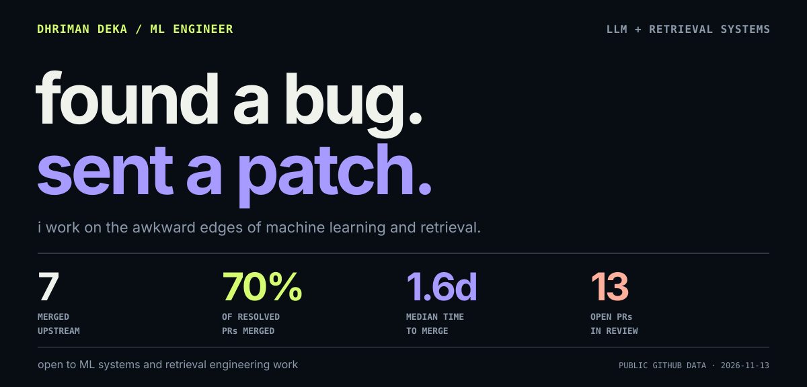
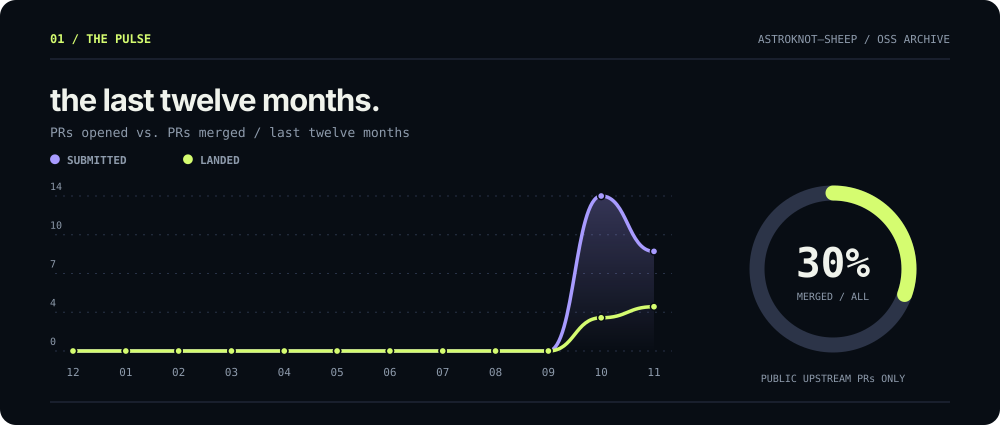
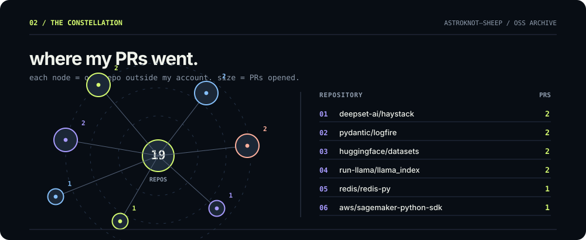
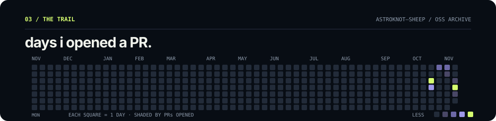

<!-- hi, thanks for looking around. -->

  

hi, i'm dhriman.

i studied economics at IISER Bhopal and ended up working on machine learning systems. lately i've spent a lot of time in other people's repositories. i like finding out why something broke, fixing it, and seeing whether the fix survives review.

and yes, the sheep in [@astroknot-sheep](https://github.com/astroknot-sheep) was deliberate. 🐑

**[pull requests](https://github.com/pulls?q=is%3Apr+author%3Aastroknot-sheep)** · **[my repositories](https://github.com/astroknot-sheep?tab=repositories)** · **[discussions](https://github.com/astroknot-sheep/astroknot-sheep/discussions)**

---

## some fixes that made it upstream

these are the kind of contributions i enjoy: specific bugs, readable changes, and a review thread where someone makes the code better.

- **[MLflow](https://github.com/mlflow/mlflow/pull/27018)** — Gemini safety blocks weren't being reported as content-filter events. fixed how the gateway handles them.
- **[Qdrant Client](https://github.com/qdrant/qdrant-client/pull/1617)** — the default tokenizer for a gRPC text index wasn't matching the expected `word` default.
- **[Haystack](https://github.com/deepset-ai/haystack/pull/13437)** — corrected line ranges when `PythonCodeSplitter` makes secondary splits.
- **[Logfire](https://github.com/pydantic/logfire/pull/2785)** — closing a generator early shouldn't look like an application error.
- **[Sentence Transformers](https://github.com/huggingface/sentence-transformers/pull/4246)** — fixed a broken training-arguments import in the examples.

there are more. the actual code and discussions are linked, so you don't have to take my word for any of it.

## pull requests, over time

<strong>where i've contributed — by repository</strong>

the numbers above count public PRs to repositories i don't own. PRs to my own repos aren't mixed in. data comes from GitHub and refreshes daily; this heatmap is about PRs, not commits.

### merged PRs — with dates and times

this is the complete upstream merge history, newest first. the timestamps come from GitHub's actual merge events, not the date the PR was closed.

<!-- MERGED_HISTORY_START -->
_this table will populate on the next dashboard refresh._
<!-- MERGED_HISTORY_END -->

### recent PRs

<!-- LIVE_PRS_START -->
| Opened | Pull request | Repo | Status |
|:--|:--|:--|:--|
| 2026-11-13 | [fix: convert common Python types in Agent tool results to JSON](https://github.com/deepset-ai/haystack/pull/13728) | deepset-ai/haystack | open |
| 2026-11-12 | [Support `@logfire.instrument` above `@classmethod` and `@staticmethod`](https://github.com/pydantic/logfire/pull/2807) | pydantic/logfire | open |
| 2026-11-12 | [Report the reducer in unified TS.MRANGE/MREVRANGE metadata on RESP2 with GROUPBY](https://github.com/redis/redis-py/pull/4634) | redis/redis-py | open |
| 2026-11-12 | [fix: pass the content type to the deserializer in LocalEndpoint.invoke](https://github.com/aws/sagemaker-python-sdk/pull/6579) | aws/sagemaker-python-sdk | open |
| 2026-11-12 | [fix(docx): close an open list before a table that follows it](https://github.com/docling-project/docling/pull/5309) | docling-project/docling | merged |
| 2026-11-11 | [Don't record GeneratorExit as an error when a generator is closed early](https://github.com/pydantic/logfire/pull/2785) | pydantic/logfire | merged |
| 2026-11-03 | [fix(html): keep colspan and rowspan of merged cells in text_as_html](https://github.com/Unstructured-IO/unstructured/pull/4658) | Unstructured-IO/unstructured | open |
<!-- LIVE_PRS_END -->

[all pull requests](https://github.com/pulls?q=is%3Apr+author%3Aastroknot-sheep) · [merged upstream](https://github.com/pulls?q=is%3Apr+is%3Amerged+author%3Aastroknot-sheep) · [still open](https://github.com/pulls?q=is%3Apr+is%3Aopen+author%3Aastroknot-sheep)

---

## things i'm making

**[KONARQ_MATRI](https://github.com/astroknot-sheep/KONARQ_MATRI)**  
a mental-health support project. i'm thinking about privacy, referrals, and where software should step aside for a human.

**[finance_transformer](https://github.com/astroknot-sheep/finance_transformer)**  
trying transformer models on financial time series. mostly a lesson in how convincing noise can look.

**[DQN for Ludo](https://github.com/astroknot-sheep/Reinforcement_Learning_DQN_for_Ludo)**  
double DQN, prioritized experience replay, and a game that makes the experiments less abstract.

older experiments and side projects

- [TWS_WriterAgent](https://github.com/astroknot-sheep/TWS_WriterAgent) — experimenting with agents.
- [ML_project_final](https://github.com/astroknot-sheep/ML_project_final) — an earlier machine learning project.
- [mlproject](https://github.com/astroknot-sheep/mlproject) — an old sandbox.
- [data-gravity-portfolio](https://github.com/astroknot-sheep/data-gravity-portfolio) — another work in progress.

## the usual tools

Python, PyTorch, TypeScript, Git, Docker, Jupyter. depends what i'm breaking that week.

## say hello

have a question about a PR? spotted a mistake? working on something similar?

you can [open a discussion](https://github.com/astroknot-sheep/astroknot-sheep/discussions). i don't mind questions, including beginner ones.

this profile's graphs are generated in-repo with Python and GitHub Actions. [source code](./scripts/generate_pr_dashboard.py).
